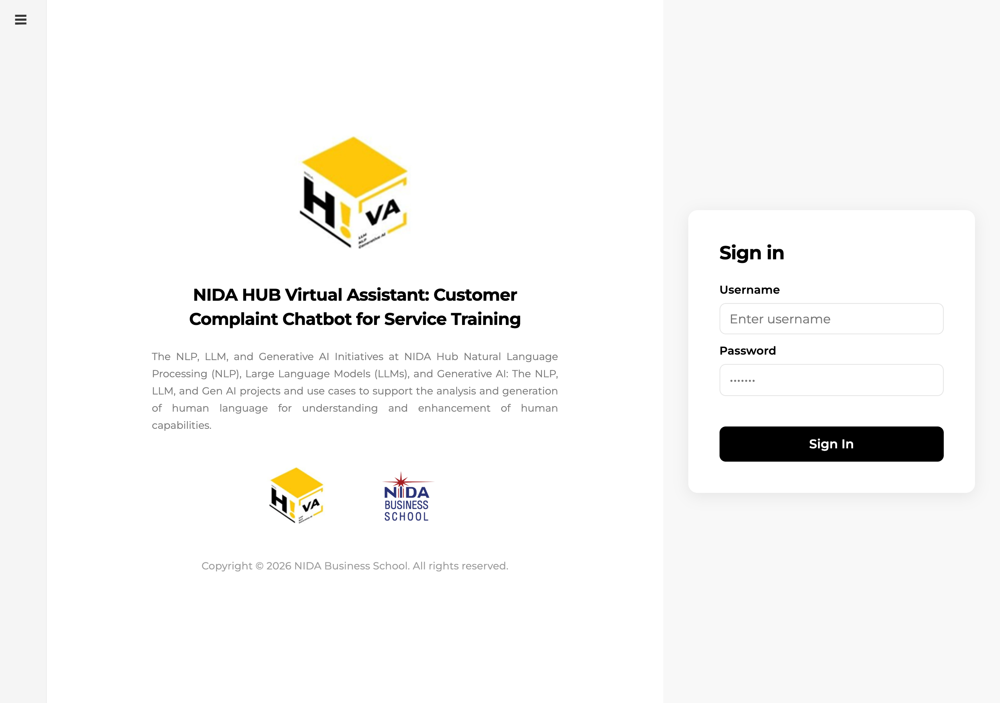
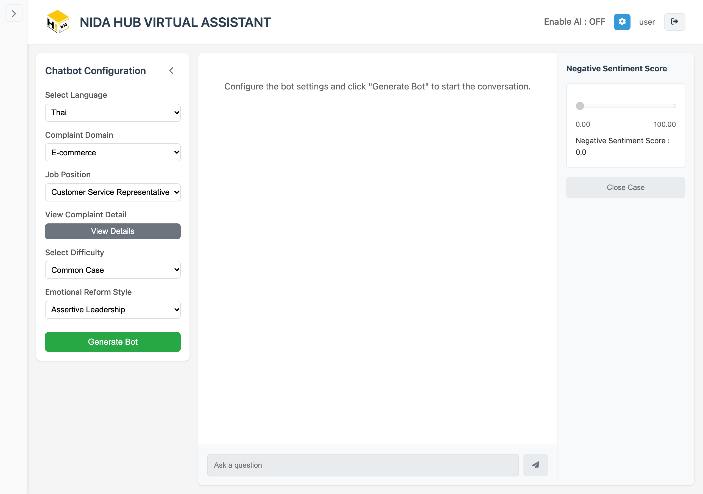
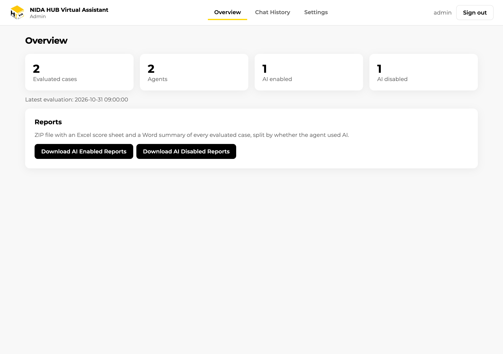
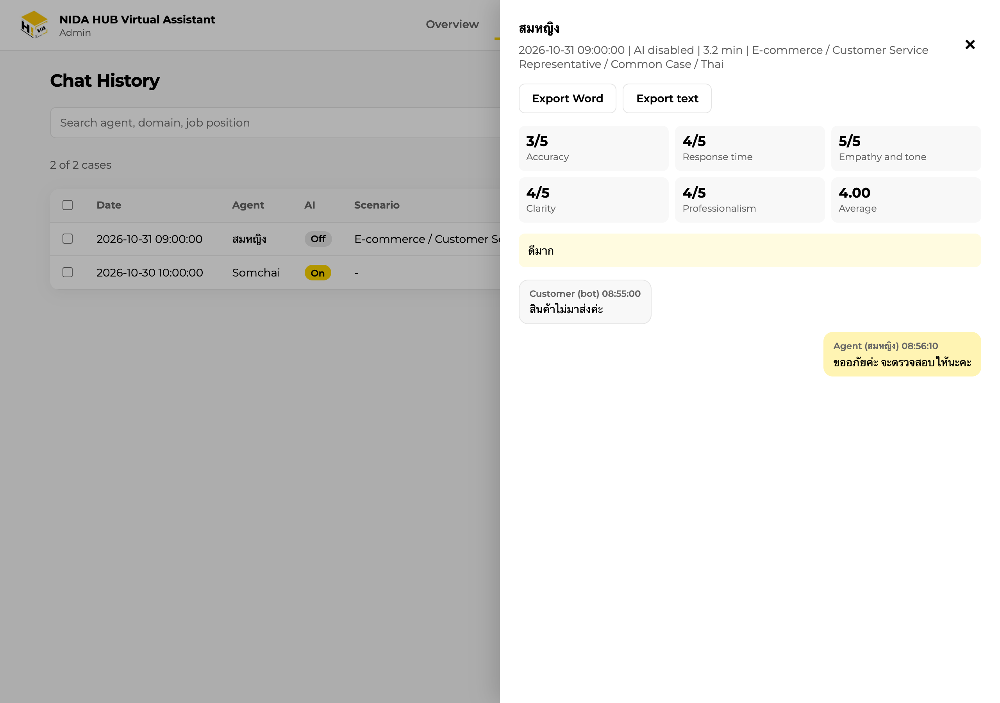
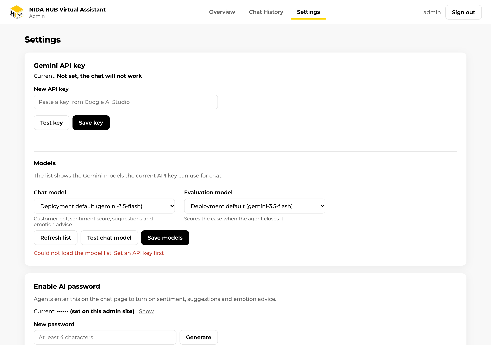
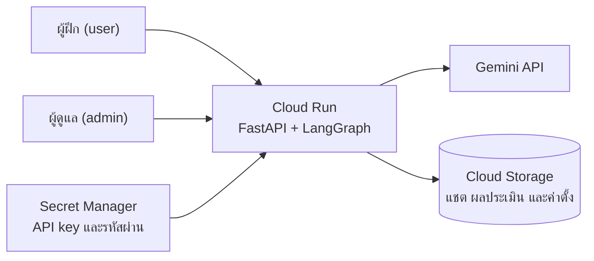

<p align="center">
  
</p>

<h1 align="center">NIDA HUB Virtual Assistant</h1>

<p align="center">
  แชตบอตจำลองลูกค้าที่ร้องเรียน สำหรับฝึกทักษะงานบริการลูกค้า ขับเคลื่อนด้วย Google Gemini
</p>

<p align="center">
  
</p>

## ภาพรวม

ผู้ฝึกเลือกสถานการณ์ที่ต้องการ แล้วแชตบอตจะสวมบทเป็นลูกค้าที่ไม่พอใจ ผู้ฝึกต้องตอบและคลี่คลายปัญหาให้ได้ เมื่อปิดเคส Gemini จะประเมินการตอบ 5 ด้าน พร้อมเขียนความเห็น ผลประเมินทุกเคสเก็บไว้ให้ผู้ดูแลดูย้อนหลังและ export ไปวิเคราะห์ต่อได้

ระบบเปิดหรือปิดตัวช่วย AI ระหว่างแชตได้ จึงใช้เปรียบเทียบผลการฝึกของกลุ่มที่ใช้และไม่ใช้ AI ได้ ตัวช่วยมี 3 อย่าง คือคะแนนความรู้สึกเชิงลบของลูกค้า คำตอบที่แนะนำ และคำแนะนำด้านอารมณ์ตามสไตล์ผู้นำที่เลือก

## ความสามารถหลัก

| ส่วน | รายละเอียด |
|---|---|
| สถานการณ์ | 90 สถานการณ์ใน 9 กลุ่มธุรกิจ เช่น E-commerce, Healthcare, Financial Services และ Government Services |
| ระดับความยาก | Common Case, Uncommon Case และ Extreme Case |
| ภาษา | ไทยและอังกฤษ |
| ตัวช่วย AI | คะแนน sentiment, คำตอบแนะนำ 3 ข้อ และคำแนะนำด้านอารมณ์แบบ Assertive, Passive หรือ Neutral Leadership เปิดได้ด้วยรหัสเปิด AI |
| การประเมิน | Accuracy, Response time, Empathy and tone, Clarity และ Professionalism ให้คะแนน 1 ถึง 5 พร้อมความเห็น |
| Admin site | ดูภาพรวม, ดาวน์โหลดรายงาน, อ่านบทสนทนารายเคส, export เป็น Word, text หรือ Excel และตั้ง Gemini API key, model และรหัสเปิด AI |

## ภาพหน้าจอ

<table>
  <tr>
    <td width="50%"></td>
    <td width="50%"></td>
  </tr>
  <tr>
    <td align="center">หน้าแชตของผู้ฝึก</td>
    <td align="center">Admin: ภาพรวมและรายงาน</td>
  </tr>
  <tr>
    <td width="50%"></td>
    <td width="50%"></td>
  </tr>
  <tr>
    <td align="center">Admin: บทสนทนาและคะแนนรายเคส</td>
    <td align="center">Admin: ตั้ง Gemini API key, model และรหัสเปิด AI</td>
  </tr>
</table>

ภาพจากข้อมูลตัวอย่าง

## บัญชีผู้ใช้

| Username | ใช้ทำอะไร |
|---|---|
| `user` | หน้าแชตสำหรับผู้ฝึก |
| `admin` | admin site ที่ `/admin` สำหรับดูรายงาน บทสนทนา และตั้งค่า (ไม่มีหน้าแชต) |

รหัสผ่านของทั้งสองบัญชีตั้งผ่านตัวแปร `ADMIN_PASSWORD` และ `USER_PASSWORD` ทุก API ตรวจสิทธิ์ที่ server และ API กลุ่ม `/api/admin/` ใช้ได้เฉพาะ admin

## สถาปัตยกรรม



แอปไม่เก็บ state ในเครื่อง ข้อมูลทั้งหมดอยู่ใน Cloud Storage จึงปิด instance เมื่อไม่มีผู้ใช้ และเพิ่ม instance เมื่อมีผู้ใช้มากได้ ค่าตั้งต้นใช้ 1 vCPU และหน่วยความจำ 512 MiB แชตที่ยังไม่ปิดเคสจะถูกลบเองหลัง 1 วัน ส่วนผลประเมินเก็บถาวร ถ้ารันบนเครื่องโดยไม่ตั้ง `DATA_BUCKET` ข้อมูลจะเก็บในโฟลเดอร์ `log/`

## เริ่มใช้งานบนเครื่อง

คัดลอก `.env.example` เป็น `.env` แล้วใส่รหัสผ่านของบัญชี `admin` และ `user` ส่วน Gemini API key จะใส่ใน `.env` ก็ได้ หรือ login เป็น admin แล้วตั้งในหน้า Settings ก็ได้

ใช้ Docker

```bash
docker build -t nida-bot:local .
```

```bash
docker run -d --name nida-bot -p 8080:8080 --env-file .env nida-bot:local
```

แล้วเปิด http://localhost:8080

หรือรันด้วย Python 3.12

```bash
pip install -r requirements.txt
```

```bash
python main.py
```

แล้วเปิด http://localhost:8000

## Deploy บน Google Cloud Run

ติดตั้งครั้งแรกด้วยคำสั่งเดียว สคริปต์จะสร้างทรัพยากรที่ต้องใช้ทั้งหมด build image ด้วย Cloud Build แล้ว deploy พร้อมแสดง URL และรหัสผ่านที่สุ่มให้

```bash
./scripts/bootstrap-gcp.sh --project <PROJECT_ID>
```

รับโค้ดเวอร์ชันใหม่

```bash
./scripts/deploy.sh --project <PROJECT_ID>
```

รายละเอียดเรื่องสิทธิ์ที่ต้องมี ทรัพยากรที่สร้าง การเปลี่ยนรหัสผ่าน ค่าใช้จ่าย และการลบระบบ อยู่ใน [DEPLOY.md](DEPLOY.md)

## ค่าตั้งค่า

| ตัวแปร | ความหมาย |
|---|---|
| `GOOGLE_API_KEY` | Gemini API key ตั้งต้น (admin ตั้งแทนได้ในหน้า Settings) |
| `ADMIN_PASSWORD`, `USER_PASSWORD` | รหัสผ่านของบัญชี `admin` และ `user` บัญชีที่ไม่ได้ตั้งรหัสจะ login ไม่ได้ |
| `AI_PASSWORD` | รหัสเปิดตัวช่วย AI ตั้งต้น (admin ตั้งแทนได้ในหน้า Settings) |
| `SECRET_KEY` | key สำหรับเซ็น cookie login ถ้าไม่ตั้ง ทุกคนต้อง login ใหม่เมื่อแอปรีสตาร์ต |
| `GEMINI_MODEL` | model ตั้งต้นสำหรับแชตและตัวช่วย AI (ค่าตั้งต้น `gemini-3.5-flash`, admin เลือกแทนได้ในหน้า Settings) |
| `GEMINI_EVAL_MODEL` | model ตั้งต้นสำหรับประเมินผลเมื่อปิดเคส (ค่าตั้งต้นเท่ากับ `GEMINI_MODEL`, admin เลือกแทนได้ในหน้า Settings) |
| `DATA_BUCKET` | ชื่อ Cloud Storage bucket ถ้าว่างจะเก็บข้อมูลในโฟลเดอร์ `log/` |

## โครงสร้างโปรเจกต์

```
├── main.py                 FastAPI: หน้าเว็บ, login, API แชต และ API ของ admin
├── graph.py                แชตบอต (LangGraph) และตัวช่วย AI ที่เรียก Gemini
├── settings.py             ค่าที่ admin ตั้งจากหน้าเว็บ
├── storage.py              เก็บข้อมูล JSON ใน Cloud Storage หรือโฟลเดอร์ log/
├── customer_complaints.csv สถานการณ์ร้องเรียนทั้งหมด
├── static/
│   ├── login.html          หน้า Sign in
│   ├── index.html          หน้าแชตของผู้ฝึก
│   └── admin.html          admin site
├── scripts/                สคริปต์ติดตั้งและดูแลระบบบน Cloud Run
├── Dockerfile
├── cloudbuild.yaml
└── DEPLOY.md               คู่มือติดตั้งบน Google Cloud
```

## เทคโนโลยี

Python 3.12, FastAPI, LangGraph, LangChain Google GenAI, Google Gemini, HTML, CSS และ JavaScript ไม่ใช้ framework รายงานใช้ pandas, openpyxl และ python-docx ส่วนการ deploy ใช้ Google Cloud Run, Cloud Build, Artifact Registry, Cloud Storage และ Secret Manager

## ทีมพัฒนา

| ชื่อ | บทบาท |
|---|---|
| รศ.ดร. จงสวัสดิ์ จงวัฒน์ผล | คณะบริหารธุรกิจ สถาบันบัณฑิตพัฒนบริหารศาสตร์ |
| ณัฐกุล พรเทพารักษ์ | Project Manager |
| โชติพงษ์ แสงขุนทด | Agentic AI Developer |

NIDA Business School, สถาบันบัณฑิตพัฒนบริหารศาสตร์
